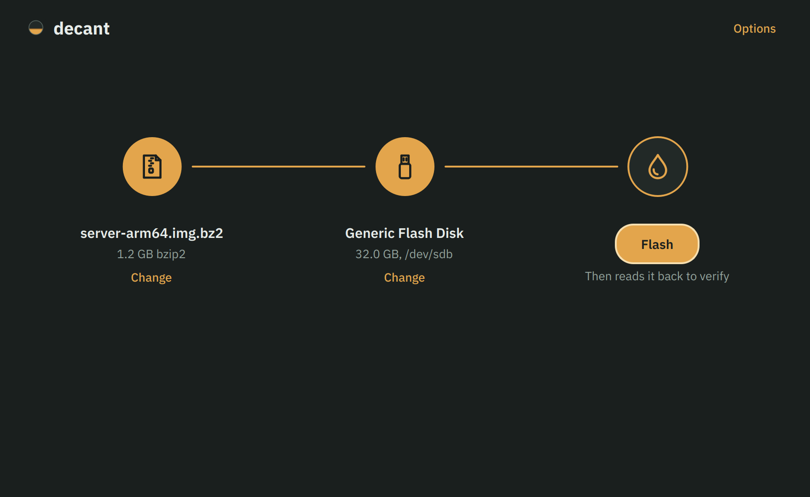

# Decant

Flash bzip2-compressed disk images to USB drives and SD cards on Linux.

Decant is a desktop front end for `bzcat`. Choose an image, choose a drive, flash, and Decant reads the drive back afterwards to check that every byte landed.



## Download

| | What it needs | Download |
|---|---|---|
| **Script** | Python 3.9+ and PySide6 | [decant.py](https://github.com/KCArrow/decant/releases/latest/download/decant.py) |
| **Portable** | Nothing extra: Python and Qt are inside | [decant-x86_64](https://github.com/KCArrow/decant/releases/latest/download/decant-x86_64) |

Both links always fetch the newest release. Checksums are in [SHA256SUMS](https://github.com/KCArrow/decant/releases/latest/download/SHA256SUMS), and older versions are on the [releases page](https://github.com/KCArrow/decant/releases).

Either one also needs `bzcat` (from bzip2), util-linux and polkit. Desktop Linux installs have all three.

## Run the script

```sh
curl -LO https://github.com/KCArrow/decant/releases/latest/download/decant.py
chmod +x decant.py
```

Install PySide6 once:

```sh
pip install --user PySide6     # any distro
sudo pacman -S pyside6         # Arch, CachyOS
```

Then start it, optionally with an image:

```sh
./decant.py
./decant.py ~/Downloads/image.img.bz2
```

To add Decant to your application menu and the "Open with" list for compressed images, run `./decant.py --install` once.

## Run the portable binary

```sh
curl -LO https://github.com/KCArrow/decant/releases/latest/download/decant-x86_64
chmod +x decant-x86_64
./decant-x86_64
```

It's built against glibc 2.28, so it's meant to run on RHEL/Rocky/Alma 8 and newer, Fedora, Arch and its derivatives, Debian 11+ and Ubuntu 20.04+, on x86_64. Each release is tested on Rocky Linux 9 and Arch Linux before it's published.

It starts a couple of seconds slower than the script because it unpacks itself on every launch. `./decant-x86_64 --install` adds it to your application menu; run it again if you move the file.

## Faster decompression

bzip2 decompression is single-threaded and is often slower than a fast USB stick. If `lbzip2` is installed, Decant uses it instead of `bzcat` and decompresses on all cores.

```sh
sudo dnf install epel-release && sudo dnf install lbzip2   # Rocky, RHEL, Alma
sudo pacman -S lbzip2                                      # Arch, CachyOS
sudo apt install lbzip2                                    # Debian, Ubuntu
```

You can switch back to plain `bzcat` under **Options**.

Decant also flashes xz, gzip and zstd images and uncompressed `.img`/`.iso` files, using `xz`, `pigz`/`gzip` or `zstd` when they're installed.

## Using it

1. **Choose image**, or drop the file anywhere on the window.
2. **Choose drive.** USB drives and SD cards are listed. If exactly one is plugged in, Decant picks it for you and says so.
3. **Flash.** Confirm, enter your password when your desktop asks, and wait.

Decant then reads the whole image back from the drive to verify it and ejects the drive. You can unplug it when it says so.

**Options** (top right):

- **Verify after writing**: read the drive back and compare. On by default.
- **Eject when finished**: on by default.
- **Use lbzip2 for bzip2 images**: on when lbzip2 is installed.
- **Add Decant to the application menu**: same as `--install`.

## Protection against erasing the wrong disk

- **System drives can't be chosen.** That means any drive holding `/`, `/boot`, `/home`, `/usr`, `/var` or swap.
- **Drives in use can't be chosen.** That covers drives used by LVM, LUKS encryption, software RAID or a ZFS pool, and read-only drives.
- **Internal drives are hidden.** To see them, tick **Show internal drives**. Erasing one also takes an extra checkbox in the confirmation.
- **Every flash asks first.** The confirmation names the drive, its size and what's on it, and **Cancel** is the default button.
- **The drive is checked against what you confirmed.** Decant compares its size and serial number when you choose it, after you confirm, and again inside the root helper just before writing. If a stick was swapped in the meantime, nothing is written.

## How it works

The window runs as you. The actual writing runs in a small helper started with `pkexec`, which is where the password prompt comes from. The helper:

1. **Unmounts** the drive's partitions. Opening the drive exclusively then fails if anything else is still using it.
2. **Streams** the image through `bzcat` (or `lbzip2`) straight onto the drive. It flushes to the device every 32 MB, so the progress you see is what has actually been written, not what's waiting in memory.
3. **Syncs**, then **verifies**: it reads the drive back, bypassing the cache, and compares a SHA-256 hash for every 32 MB block. If something doesn't match, it tells you where on the drive.
4. **Ejects** the drive, or has the kernel reread its partition table.

The percentage tracks how much of the compressed file has been read, because bzip2 files don't record their uncompressed size. The speed shown is the real write speed. Cancelling, or closing the window, stops the writer.

The helper only uses Python's standard library. In the portable build, it's the same binary.

## Command line

```
decant.py [IMAGE]          open the app, optionally with an image chosen
decant.py --list-drives    show every drive and how Decant classifies it
decant.py --install        add Decant to your application menu
decant.py --version        print the version
decant.py --screenshots D  render every screen with demo data into folder D
```

To try a full flash without a spare drive, start Decant with `DECANT_ALLOW_FILE=1 DECANT_NO_ROOT=1 ./decant.py` and Alt-click **Choose drive** to write to a plain file instead.

## Troubleshooting

**No password prompt appears, or you see "Authorization failed".** Decant asks for your password through polkit, so your desktop's authentication agent has to be running. Full desktops (GNOME, KDE, Xfce, Cinnamon) start one automatically. In a bare window manager, start one yourself, such as `lxpolkit` or `polkit-gnome-authentication-agent-1`.

**"Could not load the Qt platform plugin xcb" (script version).** Install `xcb-util-cursor` (Rocky, Fedora, Arch) or `libxcb-cursor0` (Debian, Ubuntu). The portable build includes it.

**Problems under Wayland.** Try `QT_QPA_PLATFORM=xcb ./decant.py` (or `./decant-x86_64`).

**A drive is missing from the list.** It's probably internal: tick **Show internal drives**. If it's listed but greyed out, the label beside it says why. `--list-drives` shows how Decant classifies every drive.

**Verification fails at the same place twice.** The drive is faulty, or it's a counterfeit stick that reports more capacity than it has.

## Development

```sh
python3 -m unittest discover -s tests -v          # engine tests, file targets
sudo python3 -m unittest discover -s tests -v     # also writes real loop devices
packaging/build-portable.sh                       # portable binary into dist/
```

On every push, GitHub Actions does three things:

- runs the tests;
- renders every screen;
- builds the portable binary in the `manylinux_2_28` container and tests it on Rocky Linux 9 and Arch.

Pushing a `v*` tag publishes a release with `decant.py`, `decant-x86_64` and `SHA256SUMS`.

## License

[MIT](LICENSE)
